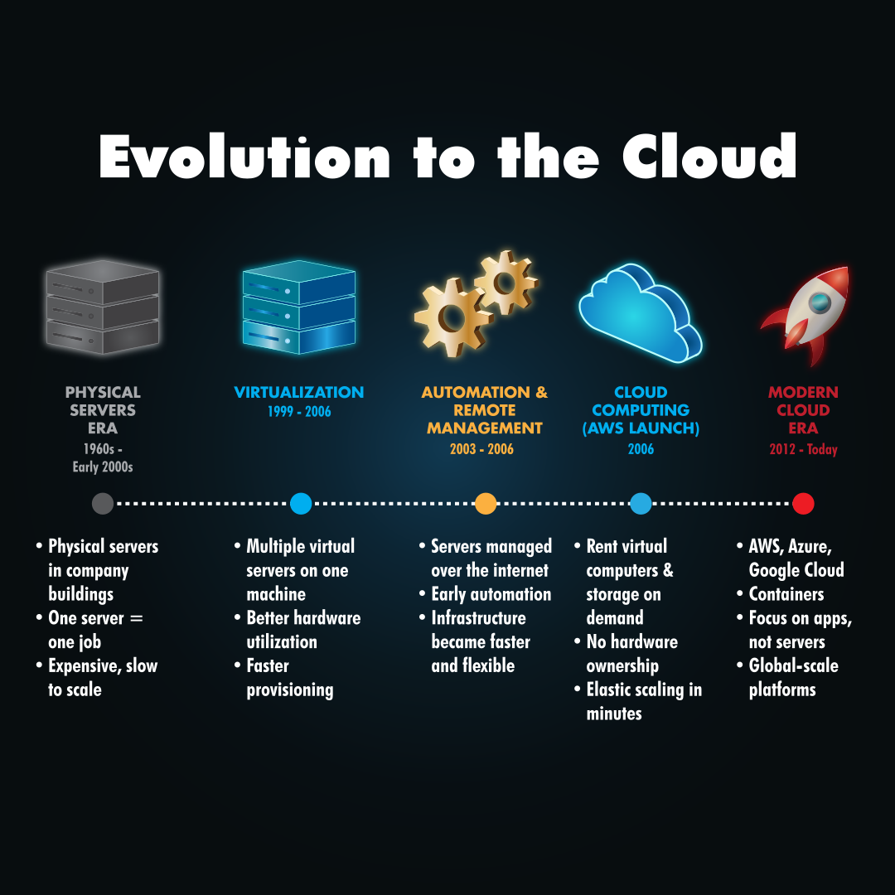

# Cloud Computing Fundamentals

*Image: TryHackMe*

## Deployment Types

These are the main types of cloud environment you can choose:

- **Public Cloud**: Used by startups, websites and global apps because it's affordable, easy to scale and needs no infrastructure management. Public cloud services suit most use cases.
- **Private Cloud**: Used by banks, healthcare and government organisations because it gives more control, customisation and compliance for sensitive data.
- **Hybrid Cloud**: Used by companies like e-commerce platforms that need to keep sensitive data private while still scaling up on the public cloud during high demand.

## Cloud Service Models

- **Infrastructure as a Service (IaaS)**: You rent basic computing resources like virtual servers, storage and networking. You manage the operating system and your application, while the provider manages the physical hardware.
- **Platform as a Service (PaaS)**: The provider manages the infrastructure and the operating system. You just focus on building, deploying and running your application without worrying about servers.
- **Software as a Service (SaaS)**: You use a complete application over the internet. The provider manages everything, and you access the software through a browser or app, for example Gmail or Zoom.

- Some leading cloud vendors are: Amazon Web Services (AWS), Microsoft Azure, Google Cloud Platform, Alibaba Cloud, IBM Cloud and Oracle Cloud.

## Basic Cloud Terminology

- **EC2 (Virtual Computer / Server)**: EC2 is AWS's virtual computer in the cloud. Just like a real computer, it has a CPU and memory (RAM) and can run applications. Every time you add an EC2 instance, you're adding a computer to your environment.
- **Instance Type (for example: t2, t3, m5)**: Instance types describe how powerful the virtual computer is. Some have more CPU and RAM, so they cost more. You choose the instance type based on your needs:
    - Bigger instances = more power + higher cost
    - Smaller instances = less power + lower cost
