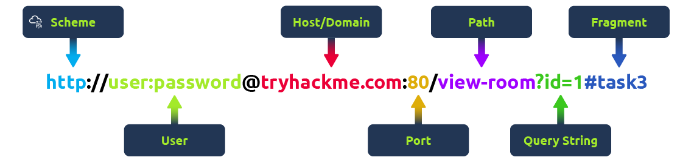
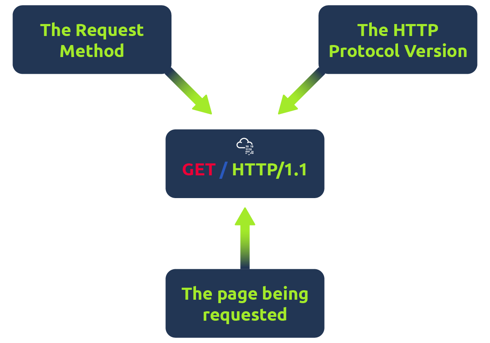

# HTTP in Detail

## URL (Uniform Resource Locator)



*Image: TryHackMe*

- **Scheme**: Tells which protocol to use to access the resource, such as HTTP, HTTPS or FTP (File Transfer Protocol).
- **User**: Some services need you to log in. You can put a username and password in the URL itself.
- **Host**: The domain name or IP address of the server you want to reach.
- **Port**: The port you connect to. Usually 80 for HTTP and 443 for HTTPS, but it can be any port from 1 to 65535.
- **Path**: The file name or location of the resource you want.
- **Query string**: Extra bits of information sent to the path. For example, `/blog?id=1` tells the blog page you want the article with the id of 1.
- **Fragment**: Points to a specific spot on the page. It's used on long pages so a link can jump straight to a certain section.

## Request



*Image: TryHackMe*

- Other data is sent in **headers**. Headers carry extra information for the web server you're communicating with (more on this in the Headers section below).

```http
GET / HTTP/1.1
Host: tryhackme.com
User-Agent: Mozilla/5.0 Firefox/87.0
Referer: https://tryhackme.com/

```

- **Line 1**: Uses the GET method (see HTTP Methods below) to ask for the home page `/`, and tells the server we're using HTTP version 1.1.
- **Line 2**: Tells the web server which website we want: tryhackme.com
- **Line 3**: Tells the web server we're using the Firefox version 87 browser.
- **Line 4**: Tells the web server which page referred us to this one: https://tryhackme.com
- **Line 5**: An HTTP request always ends with a blank line, so the web server knows the request is finished.

## Response

```http
HTTP/1.1 200 OK
Server: nginx/1.15.8
Date: Fri, 09 Apr 2021 13:34:03 GMT
Content-Type: text/html
Content-Length: 98

<html>
<head>
    <title>TryHackMe</title>
</head>
<body>
    Welcome To TryHackMe.com
</body>
</html>
```

- **Line 1**: The HTTP version the server is using (1.1), followed by the HTTP status code. Here "200 OK" means the request completed successfully.
- **Line 2**: The web server software and its version number.
- **Line 3**: The current date, time and timezone of the web server.
- **Line 4**: The Content-Type header tells the client what kind of information is being sent, such as HTML, images, videos, PDF or XML.
- **Line 5**: Content-Length tells the client how long the response is, so it can confirm no data is missing.
- **Line 6**: A blank line marks the end of the response headers.
- **Lines 7-14**: The information that was requested, in this case the home page.

## HTTP Methods

- **GET**: Used to get information from a web server.
- **POST**: Used to submit data to the web server, and possibly create new records.
- **PUT**: Used to submit data to a web server to update existing information.
- **DELETE**: Used to delete information or records from a web server.

## HTTP Status Codes

### Ranges

- **100-199 (Information response)**: Tell the client the first part of its request was accepted and it should continue sending the rest. These aren't used much anymore.
- **200-299 (Success)**: Tell the client the request was successful.
- **300-399 (Redirection)**: Redirect the client's request to another resource, like a different web page or a different website altogether.
- **400-499 (Client errors)**: Tell the client there is an error with its request.
- **500-599 (Server errors)**: Indicate an error on the server side.

### Some Common Codes

1. **200 - OK**: The request was successful.
2. **201 - Created**: Something new was created (like a new user or post).
3. **301 - Moved Permanently**: The page has moved to a new address for good.
4. **302 - Found**: A temporary redirect.
5. **400 - Bad Request**: Something in the request was wrong or missing.
6. **401 - Unauthorised**: You need to log in first.
7. **403 - Forbidden**: You don't have permission, whether you're logged in or not.
8. **404 - Page Not Found**: The page doesn't exist.
9. **405 - Method Not Allowed**: For example, a GET request sent to an endpoint that only accepts POST.
10. **500 - Internal Server Error**: The server hit an error and couldn't handle your request.
11. **503 - Service Unavailable**: The server is overloaded or down for maintenance.

## Headers

- Headers are additional bits of data the client can send to the server while making a request.
- Headers aren't strictly required when browsing a website, but without them it's hard to view websites properly.

### Common Request Headers

- **Host**: Some web servers host multiple websites, so this header tells the server which website you want. Without it, you get the server's default website.
- **User-Agent**: Tells the server your browser software and version number, so it can send back the website formatted best for your browser.
- **Content-Length**: Tells the server how much data is being sent, so it can check that no data is missing.
- **Accept-Encoding**: Tells the web server which types of compression the browser supports, so the data can be made smaller for sending over the internet.
- **Cookie**: Data sent to the server to help it remember your information.

### Common Response Headers

- These are the headers sent back to the client after a request.
- **Set-Cookie**: Information to store, which gets sent back to the web server on every request.
- **Cache-Control**: How long to store the content of the response in the browser's cache before requesting it again.
- **Content-Type**: Tells the client what type of data is being returned (HTML, JS, CSS, etc.).
- **Content-Encoding**: Which method was used to compress the data to make it smaller to send over the internet.

## Cookies

- Cookies set by the server (with Set-Cookie) are saved by the browser.
- They are used to keep track of your requests on the server side, because HTTP itself is stateless (it doesn't remember previous requests).
- Cookies can be used for many things, but they're mainly used for website authentication (keeping you logged in).
- The cookie value usually isn't a human-readable string, but a token (a hard-to-guess random value).
