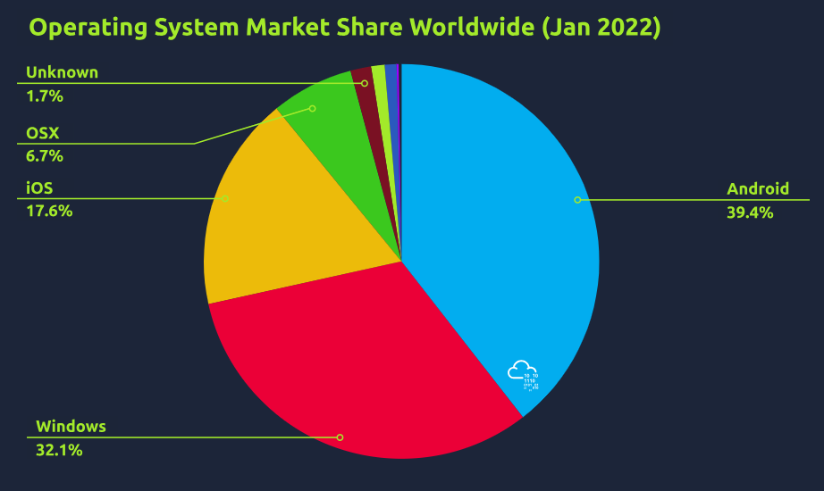

# Operating System Security

- The Operating System (OS) is the layer that sits between the hardware and the applications and programs you run.

*Image: TryHackMe*

## CIA Triad

Because of all the data we save on our devices, we want it to be secure. When we talk about security, we think about protecting three things:

- **Confidentiality**: Secret and private files and information are only available to the people meant to see them.
- **Integrity**: No one can tamper with files, whether they're stored on your system or being sent over the network.
- **Availability**: Your laptop or phone is ready to use whenever you need it.

## Three Weaknesses Targeted by Attackers

1. Authentication and weak passwords
2. Weak file permissions
3. Malicious programs

## Authentication and Weak Passwords

Authentication (proving who you are) can be done in three main ways:

- **Something you know**: a password or PIN code.
- **Something you are**: a fingerprint.
- **Something you have**: a phone that receives an SMS code.

## Weak File Permissions

- Good security follows the **principle of least privilege**: every user gets only the access they actually need, and nothing more.
- Weak file permissions make it easy for an attacker to attack confidentiality and integrity.
- They attack confidentiality because weak permissions let them access files they shouldn't be able to.
- They attack integrity because they might change files they shouldn't be able to edit.

## Malicious Programs

- Some types of malicious programs, like Trojan horses, give the attacker access to your system.
- The attacker can then read your files or even change them.
- Some malicious programs attack availability.
- One example is **ransomware**: a malicious program that encrypts the user's files so they can't be opened, and usually demands payment to unlock them.
