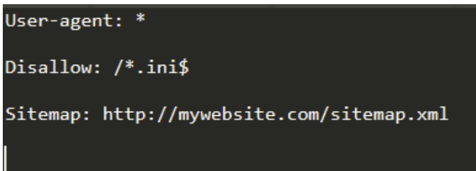
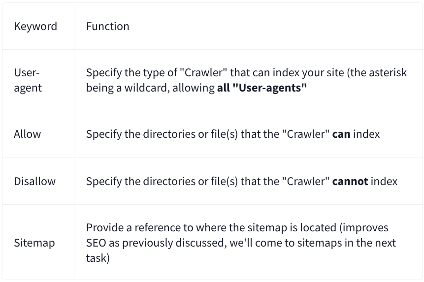

# Web Scraping

## Web Crawling

- It's used to index websites (build a searchable list of their pages).
- Tools called **spiders** (crawlers) are used to crawl the web.
- Used for search engine indexing, SEO audits (looking for broken links and outdated content) and content aggregation.

## Web Scraping

- It's an automated way to extract specific information from a website.
- Some example uses of web scraping: price monitoring, brand monitoring, and collecting data to build AI models.

Sometimes both are used together. A scraper is good when you have to run it on a single page, but to move around a website and through multiple pages, it needs to be paired with a crawler.

## robots.txt

- A website can use a `robots.txt` file to tell crawlers which parts of the site they can and can't index.

*Images: TryHackMe*
